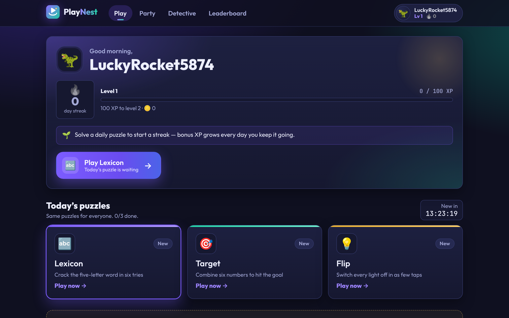
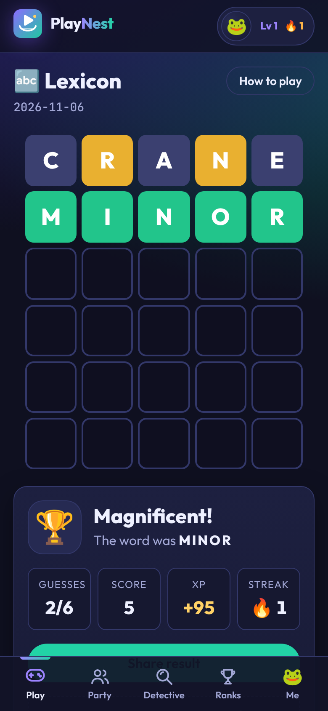

# PlayNest

A browser gaming site you can play instantly, with no signup. It has daily puzzles, real-time party games and AI-generated mystery cases, plus streaks, XP, levels, achievements and leaderboards to keep players coming back.

| | |
|---|---|
|  |  |

## Games

| Game | Type | Notes |
|---|---|---|
| **Lexicon** | Daily word puzzle | Guess the 5-letter word in 6 tries. Everyone gets the same word each day. |
| **Target** | Daily numbers puzzle | Combine 6 numbers with + − × ÷ to hit the target. |
| **Flip** | Daily logic puzzle | Tapping a light toggles it and its neighbours. Turn every light off in the fewest taps. |
| **Reflex** | 60-second arcade | Tap targets before they vanish. Unlimited plays; your best score each day goes on the leaderboard. |
| **Trivia Blitz** | Multiplayer party | Real-time quiz for up to 12 players, who join with a 4-letter room code. |
| **Reaction Duel** | Multiplayer party | Wait for green, then tap first. Tapping early costs points. |
| **Detective** | AI mystery | Question 4 suspects and accuse the culprit. Cases are written by Claude, or built-in cases are used if no API key is set. |

**What keeps players engaged:**
- A guest account is created automatically, and players can claim it later to keep their progress.
- Daily streaks give bonus XP.
- Levels, coins and 17 achievements.
- Toast celebrations when you earn something.
- Shareable emoji results.
- Daily, weekly and all-time leaderboards.
- An installable app (PWA) that works offline.
- Mobile-first layout.

## Tech stack

- **Frontend:** React 19 + Vite + React Router (`client/`)
- **Backend:** Node 22 + Express 5, with WebSockets via `ws` (`server/`)
- **Database:** PostgreSQL on [Neon](https://neon.tech). Tables are created automatically on startup from `server/src/schema.sql`.
- **AI:** Anthropic Claude API (`@anthropic-ai/sdk`) for the Detective game
- **Hosting:** [Render](https://render.com). One web service runs the API, the WebSockets and the React app.

## Run locally

You need Node 22+ and a Postgres database (a Neon database works fine).

1. Install dependencies:

```bash
npm install --prefix server && npm install --prefix client
```

2. Create your config file:

```bash
cp server/.env.example server/.env
```

Then edit `server/.env` and set `DATABASE_URL` and `JWT_SECRET`.

3. Start the backend on port 3001, in one terminal:

```bash
npm run dev:server
```

4. Start the frontend on port 5173, in another terminal:

```bash
npm run dev:client
```

5. Open http://localhost:5173.

To run the tests:

```bash
npm test
```

## Deploy to Render + Neon

1. **Neon:** create a project and copy the connection string. It ends with `?sslmode=require`.
2. **Render:**
   1. Go to **New → Blueprint**, pick this repo, and Render reads `render.yaml`.
   2. When prompted, set `DATABASE_URL` to your Neon connection string. `JWT_SECRET` is generated for you.
   3. Optionally set `ANTHROPIC_API_KEY` to turn on AI-generated detective cases.
3. Deploy. Render runs `npm run build` (installs everything and builds the React app) and then `npm start`.

Party rooms live in the server's memory. Run a single instance, and use a paid plan so the server doesn't sleep in the middle of a game.

## Environment variables

| Variable | Required | Description |
|---|---|---|
| `DATABASE_URL` | yes | Postgres connection string (Neon) |
| `JWT_SECRET` | yes (prod) | Secret used to sign login tokens |
| `ANTHROPIC_API_KEY` | no | Turns on AI-generated detective cases |
| `CLAUDE_MODEL` | no | Model for detective cases (default `claude-opus-5-5`) |
| `DETECTIVE_DAILY_LIMIT` | no | AI cases allowed per user per day (default 3), to control cost |
| `PORT` | no | Server port (Render sets this automatically) |

## Project layout

```
server/src/
  index.js          Express app, static hosting, startup
  schema.sql        Database tables
  auth.js           Guest accounts, sign-up, login (JWT)
  progress.js       XP, levels, streaks, achievements
  routes/           daily.js, detective.js, profile.js (profile + leaderboard)
  games/            Daily puzzle logic (lexicon, target, flip, reflex)
  party/            Multiplayer room engine + trivia questions
  detective/        Claude integration + built-in cases
client/src/
  pages/            One page per route
  components/       Layout, nav, toasts
  games/            Shared game UI (result panel, sharing, countdowns)
  lib/              API client + session
SPEC.md             Full product and API spec
```
